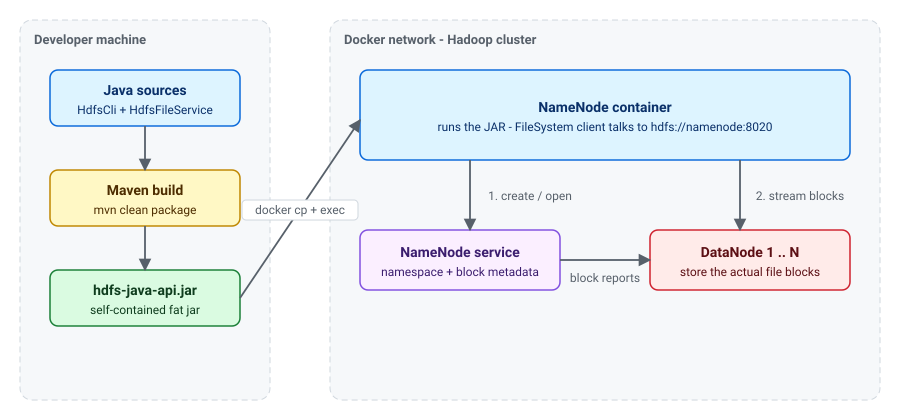
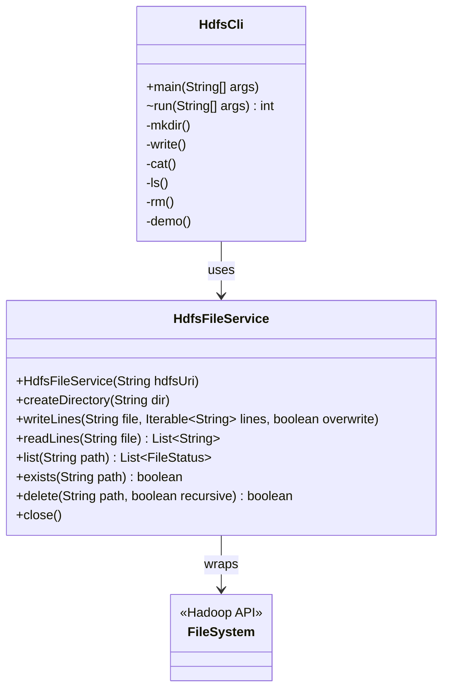
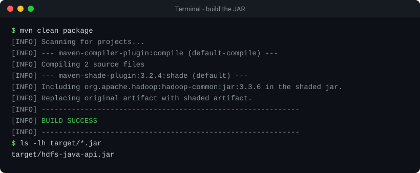
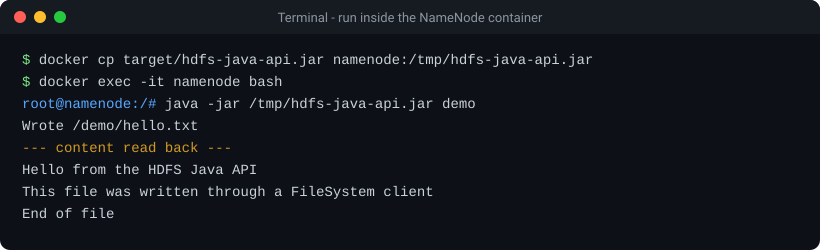
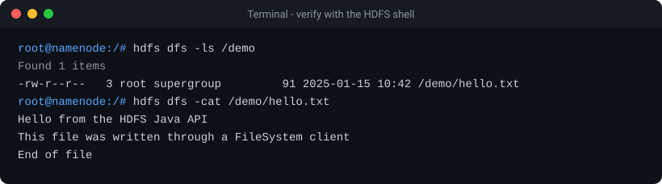
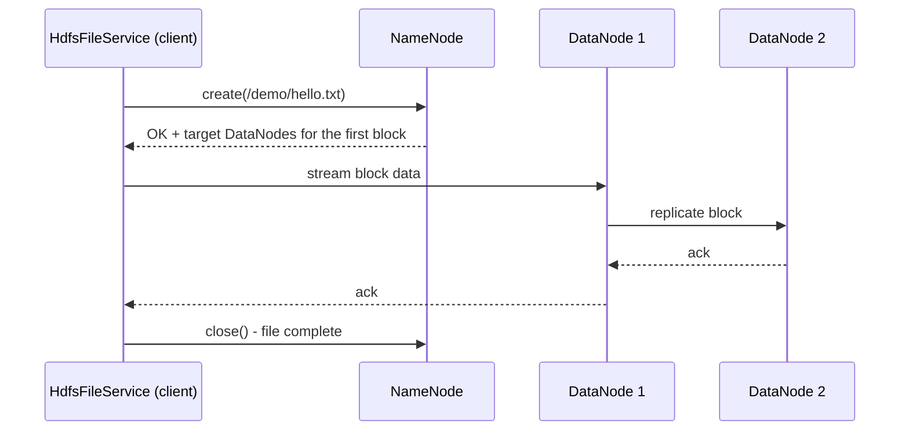

# HDFS_File_CLI

command-line tool that shows how to work with **HDFS** (Hadoop Distributed File System) from Java using the Hadoop `FileSystem` API. It can create directories, write and read text files, list directories and delete paths on a running cluster

  

## Overview

| Capability | Command |
| --- | --- |
| Create a directory | `mkdir <path>` |
| Write lines to a file | `write <path> <line>...` |
| Print a file | `cat <path>` |
| List a directory | `ls [path]` |
| Delete a file or directory | `rm [-r] <path>` |
| Write a sample file and read it back | `demo` |

## Architecture

The JAR is built on your machine and executed inside the NameNode container, where the `namenode` hostname resolves and the cluster is reachable



The code is split into two small classes: a CLI that parses arguments, and a service that wraps the Hadoop API



## Project layout

```text
.
├── pom.xml                                  # Maven build (fat JAR via shade plugin)
├── LICENSE
├── README.md
├── docs/images/                             # diagrams and sample terminal output
└── src/main/java/com/example/hdfs/
    ├── HdfsCli.java                         # command-line entry point
    └── HdfsFileService.java                 # thin wrapper over the Hadoop FileSystem API
```

## Prerequisites

- **JDK 8** or newer (the project targets Java 8 bytecode)
- **Maven 3.6+**
- **Docker** with a running Hadoop cluster (one NameNode container reachable as `namenode`, plus at least one DataNode)

## Quick start

### 1. Get the code

```bash
git clone https://github.com/walidwh21/HDFS_File_CLI
cd https://github.com/walidwh21/HDFS_File_CLI
```

### 2. Build the JAR

```bash
mvn clean package
```

This produces a self-contained JAR at `target/hdfs-java-api.jar`



### 3. Start your Hadoop cluster

Make sure the NameNode and at least one DataNode are running (Docker Desktop, `docker compose up -d`, or any equivalent setup)

### 4. Run it inside the NameNode container

```bash
docker cp target/hdfs-java-api.jar namenode:/tmp/hdfs-java-api.jar
docker exec -it namenode bash
java -jar /tmp/hdfs-java-api.jar demo
```



### 5. Verify with the HDFS shell

```bash
hdfs dfs -ls /demo
hdfs dfs -cat /demo/hello.txt
```



## Command reference

```text
java -jar hdfs-java-api.jar [--uri hdfs://host:port] [--overwrite] <command> [args]
```

| Option / command | Description |
| --- | --- |
| `--uri <uri>` | NameNode address. Overrides the `HDFS_URI` environment variable. |
| `--overwrite` | Allow `write` to replace an existing file (otherwise it fails). |
| `mkdir <path>` | Create a directory, including missing parents. |
| `write <path> <line>...` | Write each argument as one line (UTF-8). |
| `cat <path>` | Print the file to standard output. |
| `ls [path]` | List a directory (defaults to `/`). |
| `rm [-r] <path>` | Delete a file; use `-r` for non-empty directories. |
| `demo` | Write `/demo/hello.txt`, then read it back. |

The address is resolved in this order: `--uri`, then the `HDFS_URI` environment variable, then `hdfs://namenode:8020`

Examples:

```bash
java -jar hdfs-java-api.jar mkdir /data/reports
java -jar hdfs-java-api.jar write /data/reports/hello.txt "first line" "second line"
java -jar hdfs-java-api.jar --overwrite write /data/reports/hello.txt "replaced"
java -jar hdfs-java-api.jar cat /data/reports/hello.txt
java -jar hdfs-java-api.jar --uri hdfs://my-cluster:9000 ls /data
java -jar hdfs-java-api.jar rm -r /data/reports
```

Exit codes: `0` success, `1` HDFS or runtime error, `2` invalid usage

## How a write works

When the client creates a file, the NameNode only records metadata; the data itself flows directly from the client to the DataNodes, which replicate it among themselves


